# Challenge Kiratech: highly available Kubernetes on Lima

A 5-node HA Kubernetes cluster (kubeadm, stacked etcd) in Lima VMs on macOS, with a kube-vip virtual IP in front
of the API servers and Calico networking. Scripted and tested operations (failover, etcd backup/restore,
zero-downtime minor upgrade), plus a self-service **TeamEnvironment** API (Crossplane + Argo CD).

| Role | VMs | Address | Notes |
|---|---|---|---|
| Control plane | `cp1` `cp2` `cp3` | 192.168.105.x (`lima0`) | 2 vCPU / 2.5 GiB, stacked etcd, kube-vip static pod |
| Workers | `w1` `w2` | 192.168.105.x (`lima0`) | 2 vCPU / 3 GiB |
| API endpoint (VIP) | n/a | `192.168.105.200:6443` | kube-vip, ARP mode, leader election |
| Pod network | n/a | `10.244.0.0/16` | Calico (tigera-operator), pinned to `lima0` |
| Kubernetes | n/a | v1.34 (upgrade tested to v1.35) | containerd 2.x, Ubuntu 24.04 arm64 |

| Path | Purpose |
|---|---|
| [lima/k8s-node.yaml](lima/k8s-node.yaml) | VM template: Ubuntu 24.04, containerd, kubeadm/kubelet/kubectl, `lima: shared` network |
| [bootstrap-cluster.sh](bootstrap-cluster.sh) | Builds the cluster on the 5 VMs |
| [ops/](ops) | Part 2 scripts (`a-failover.sh`, `b-backup-restore.sh`, `c-upgrade.sh`) and their logs in [ops/logs/](ops/logs) |
| [platform/](platform) | Part 3: `bootstrap-platform.sh`, `demo.sh`, the Git repos it seeds (`repos/`), logs |
| [docs/diagrams/](docs/diagrams) | C4 diagrams: Mermaid source (`.mmd`) and rendered `.svg`/`.png` |
| [docs/part3-test-guide.md](docs/part3-test-guide.md) | Manual Part 3 test, CLI and GUI |
| [docs/ai-usage-log.md](docs/ai-usage-log.md) | Where the AI assistant helped and where it was wrong |

## Quick start (all commands, from `challenge/` on the Mac)

```sh
# 1. one-time host setup (needs sudo, see §1)
brew install socket_vmnet lima kubectl
sudo mkdir -p /opt/socket_vmnet/bin
sudo cp /opt/homebrew/opt/socket_vmnet/bin/socket_vmnet /opt/socket_vmnet/bin/
sudo chown -R root:wheel /opt/socket_vmnet
limactl sudoers | sudo tee /etc/sudoers.d/lima

# 2. VMs (~3 min)
for v in cp1 cp2 cp3; do limactl create --name=$v --cpus=2 --memory=2.5 --disk=20 --tty=false lima/k8s-node.yaml; done
for v in w1 w2;       do limactl create --name=$v --cpus=2 --memory=3   --disk=30 --tty=false lima/k8s-node.yaml; done
for v in cp1 cp2 cp3 w1 w2; do limactl start $v; done

# 3. cluster (~5 min) and kubectl from the Mac
./bootstrap-cluster.sh                     # also writes ~/.kube/lima-ha.conf on the Mac
export KUBECONFIG=~/.kube/lima-ha.conf     # needed in every new terminal
kubectl get nodes

# 4. Part 2 (in this order)
cd ops
./a-failover.sh       > logs/a-failover.log 2>&1         # ~2 min
./b-backup-restore.sh > logs/b-backup-restore.log 2>&1   # ~2 min, API down ~1 min
./c-upgrade.sh        > logs/c-upgrade.log 2>&1          # ~20 min, v1.34 -> v1.35 (one-shot)
cd ..

# 5. Part 3
cd platform
./bootstrap-platform.sh > bootstrap-platform.log 2>&1    # ~3 min, idempotent
./demo.sh > logs/part3-demo.log 2>&1                     # ~2 min, last line: RESULT: all Part 3 checks behaved as expected
```

Keep the Mac awake during long runs (`caffeinate -dims`). To start over: `limactl delete -f cp1 cp2 cp3 w1 w2`.

## Architecture (C4)

| Container: platform control plane and managed cluster | Deployment: VMs, nodes, API endpoint, etcd, CNI |
|---|---|
| [](docs/diagrams/c4-container.mmd) | [](docs/diagrams/c4-deployment.mmd) |

Click an image for its Mermaid source. In the lab, one cluster is both the management cluster and the workload
cluster: Argo CD deploys to `https://kubernetes.default.svc`. Re-render after editing a `.mmd` file:
`npx -y @mermaid-js/mermaid-cli@11.4.2 -i docs/diagrams/c4-container.mmd -o docs/diagrams/c4-container.svg -b white`
(same for `.png` and for `c4-deployment`).

---

## 1. Prerequisites

Lima's default `vzNAT` network isolates the VMs from each other, so `kubeadm join` times out against the VIP. The
VMs therefore use `lima: shared` (socket_vmnet, `192.168.105.0/24`, which also contains the VIP). socket_vmnet must
be in a root-owned path, hence the `sudo` steps above. `limactl sudoers --check` must report that the file is up to date.

## 2. Build the cluster

After `limactl start`, check that every VM can reach the others, e.g. `limactl shell cp2 -- ping -c1 -W2 192.168.105.3`.
The template installs from the `K8S_MINOR="v1.34"` apt repository; change it to start on another minor.

`./bootstrap-cluster.sh`:

0. checks that every VM was created from `lima/k8s-node.yaml` (has `lima0` on 192.168.105.0/24 and `kubeadm`), and stops with a clear error otherwise;
1. sets kubelet `--node-ip` to the `lima0` address on every VM (all Lima VMs share the same `eth0` address);
2. on `cp1`: writes the kube-vip static pod (using `super-admin.conf`, required during `kubeadm init` on 1.29+),
   runs `kubeadm init --control-plane-endpoint 192.168.105.200:6443 --upload-certs`, and installs Calico with the pod
   CIDR changed to `10.244.0.0/16` (Calico's default `192.168.0.0/16` overlaps the VM network) and autodetection
   pinned to `lima0`;
3. joins `cp2`, then `cp3`, as control planes (waiting for `Ready`) and adds kube-vip to each;
4. joins `w1` and `w2`;
5. switches kube-vip on `cp1` back to `admin.conf` and sets up `~/.kube/config` on every control plane;
6. copies `admin.conf` to `~/.kube/lima-ha.conf` on the Mac (written to a temp file first, so a failed copy never leaves an empty file).

Health check:

```sh
kubectl get nodes -o wide                       # 3 control-plane + 2 workers Ready, INTERNAL-IP 192.168.105.x
kubectl get pods -A                             # everything Running
curl -sk https://192.168.105.200:6443/healthz   # ok
kubectl -n kube-system exec etcd-cp1 -- etcdctl --endpoints=https://127.0.0.1:2379 \
  --cacert=/etc/kubernetes/pki/etcd/ca.crt --cert=/etc/kubernetes/pki/etcd/server.crt \
  --key=/etc/kubernetes/pki/etcd/server.key endpoint health --cluster -w table   # 3 x true
```

---

## 3. Operating the cluster (Part 2)

Each script prints every command followed by its output. Excerpts below; full output in [ops/logs/](ops/logs).

### 3a. Failure tolerance

[ops/a-failover.sh](ops/a-failover.sh) force-stops the control plane that **holds the VIP** (the worst case) and
polls `/healthz` through the VIP every second:

```text
VIP 192.168.105.200 is held by: cp1  (worst case: we kill it). kubectl will be run from: cp2
Seconds without an answer on the VIP during failover: 4
VIP holder now: cp2
$ kubectl create namespace ha-test                    -> namespace/ha-test created
$ kubectl create configmap written-during-outage ...  -> configmap/written-during-outage created
$ kubectl get --raw=/readyz?verbose                   -> readyz check passed
etcd endpoint health: 2 x true, https://192.168.105.3:2379 false (context deadline exceeded)
~40 s later: cp1 NotReady. After `limactl start cp1`: Ready, etcd 3/3 healthy.
```

**If a second control plane is lost:** etcd needs a majority (quorum = ⌊n/2⌋+1 = 2 of 3), so with 1 of 3 left:

- etcd refuses reads and writes (consistency over availability, no split brain), so **the API is down**: nothing can
  be created, changed, scaled or deleted;
- **running Pods keep running** (kubelet, containerd, kube-proxy and Calico work from local state), but nothing is
  managed: no scheduling, no self-healing, no endpoint updates, no rollouts;
- the VIP may disappear too: kube-vip's leader election uses a Lease in the API;
- **recovery:** bring one node back and quorum returns with no data loss. If both are gone for good, restore a snapshot
  (§3b) or start the survivor with `--force-new-cluster` and re-add members.

To survive two simultaneous failures you need 5 members.

### 3b. etcd backup and restore

[ops/b-backup-restore.sh](ops/b-backup-restore.sh):

1. creates namespace `backup-demo` (Deployment, Service, ConfigMap, Secret);
2. takes a snapshot with `etcdctl snapshot save` inside the etcd pod, and checks it with `etcdutl snapshot status`
   (same version as the running etcd, downloaded by the script);
3. creates a ConfigMap *after* the snapshot, then deletes the namespace;
4. restores on **all three** members from the **same** snapshot:
   - move `kube-apiserver.yaml` and `etcd.yaml` out of `/etc/kubernetes/manifests` on every node; wait for ports 2379/6443 to close;
   - on every node, `mv /var/lib/etcd /var/lib/etcd.pre-restore-<ts>`, then
     `etcdutl snapshot restore ... --name <node> --initial-cluster 'cp1=https://...:2380,...' --initial-cluster-token etcd-restore-<ts> --initial-advertise-peer-urls https://<node-ip>:2380 --data-dir /var/lib/etcd`;
   - put `etcd.yaml` back everywhere, then `kube-apiserver.yaml`.

```text
| ffa15914 |    21199 |        552 |      14 MB |   3.6.0 |      <- snapshot status
API on https://192.168.105.200:6443 healthy after ~1s
$ kubectl get namespace backup-demo                    -> backup-demo   Active
$ kubectl -n backup-demo get configmap app-config ...  -> hello-from-before-the-backup
$ kubectl get configmap created-after-backup -n default
Error from server (NotFound) ...  -> as expected: everything written after the snapshot is lost
etcd: 3 members started (new member IDs), 3 x healthy; all pods Running
```

**Risks of a restore in production:**

- **Data loss back to the snapshot (RPO):** new objects disappear, and deletions and updates are reverted too
  (rotated Secrets, scaled Deployments and RBAC changes come back in their old form).
- **Partial restores corrupt the cluster:** every member needs the same snapshot and a new cluster token, and every API server must be stopped.
- **The snapshot holds every Secret** in clear text unless encryption at rest is configured: store it encrypted,
  off-cluster, with tight access. The script deletes its local copy at exit.
- **Versions must match** the etcd/Kubernetes version the snapshot came from.
- **An untested backup is not a backup:** automate snapshots, keep several generations, rehearse restores.

### 3c. Upgrade by one minor version without downtime

> Evidence from the original run (v1.34.12 → v1.35.9). Not re-run in the latest end-to-end test, because it
> permanently moves the cluster to the next minor. To repeat it, rebuild the cluster first.

[ops/upgrade-demo.yaml](ops/upgrade-demo.yaml) runs nginx with 2 replicas, `PodDisruptionBudget minAvailable: 1`,
`maxUnavailable: 0`, anti-affinity across `w1`/`w2`, a 1 s readiness probe, `preStop: sleep 10` and NodePort 30080.
[ops/probe.sh](ops/probe.sh) requests it on `w1` and on `w2` once per second throughout the upgrade.

**Order of operations** ([ops/c-upgrade.sh](ops/c-upgrade.sh)):

0. pre-flight: healthy cluster, fresh etcd snapshot, PDB in place;
1. switch the apt repo on every node to `v1.35` (repos are per minor) and pick the patch (`apt-cache madison kubeadm`);
2. `cp1`: upgrade the `kubeadm` package → `kubeadm upgrade plan` → `kubeadm upgrade apply v1.35.x` → drain → upgrade
   kubelet + kubectl → restart kubelet → uncordon;
3. `cp2`, then `cp3`: same, but with `kubeadm upgrade node` (CoreDNS/kube-proxy are upgraded after the last control plane);
4. `w1`, then `w2`: `kubeadm upgrade node` → drain → kubelet + kubectl → uncordon; wait for the workload to be `2/2`;
5. verify node versions, control-plane images, pods, `tigerastatus`, probe results.

The control planes go first because a kubelet must never be newer than the API server. Nodes go one at a time so etcd
keeps quorum and there is spare capacity. Every node is drained so the PDB protects the workload.

**Version skew rules** ([policy](https://kubernetes.io/releases/version-skew-policy/)):

| Component | Rule | Here |
|---|---|---|
| kubeadm | one minor at a time, binary = target version | 1.35 kubeadm installed first on each node |
| kube-apiserver (HA) | instances within 1 minor of each other | 1.34/1.35 mixed while rolling cp1 → cp3 |
| controller-manager, scheduler | not newer than their apiserver | they talk to the node's own apiserver, upgraded together |
| kubelet | not newer than the apiserver, up to 3 minors older | workers stayed on 1.34 until last |
| kube-proxy | not newer than the apiserver, up to 3 minors older | upgraded by kubeadm after the last control plane |
| kubectl | ±1 minor of the apiserver | 1.34 kubectl worked against mixed API servers |

Nuance: kubeadm's flow upgrades each control plane's kubelet right after its control plane, so for a few minutes cp1's
1.35 kubelet can reach a 1.34 API server through the VIP. The strictly compliant alternative is to run
`kubeadm upgrade` on all three control planes before touching any kubelet.

**Result** (full output in [c-upgrade.log](ops/logs/c-upgrade.log) and [c-upgrade-probe.log](ops/logs/c-upgrade-probe.log)):

```text
all 5 nodes v1.34.12 -> v1.35.9; control-plane images v1.35.9, etcd 3.6.6; all pods Running; tigerastatus all Available
http://192.168.105.2:30080/            probes=826   failed=0     (nginx via w1)
http://192.168.105.4:30080/            probes=826   failed=0     (nginx via w2)
https://192.168.105.200:6443/healthz   probes=816   failed=7     (API via VIP, informational)
```

**Zero failed requests for the workload.** The 7 API misses happened while a kube-apiserver static pod restarted and
the VIP moved. kubectl retries through that, and workloads don't depend on the API server.

---

## 4. Platform control plane: self-service team environments (Part 3)

**Option B (Crossplane + Argo CD)** on the same cluster. One `TeamEnvironment` resource, committed to Git or
applied with kubectl, creates the namespace, ResourceQuota + LimitRange, RBAC for the team's group, default-deny
NetworkPolicy (+ DNS), and an Argo CD Application for the team's repository.

```yaml
apiVersion: platform.kiratech.io/v1alpha1
kind: TeamEnvironment
metadata:
  name: blue                 # must equal spec.teamName
spec:
  teamName: blue             # 2-20 chars [a-z0-9-], immutable
  size: S                    # S | M | L
  repoURL: http://gitea-http.gitea.svc.cluster.local:3000/platform/team-blue-app.git
```

`bootstrap-platform.sh` installs Gitea (lab Git server, :30300), Argo CD (UI on :30090) and Crossplane, seeds the
two repos below, and applies the root Argo CD apps ([platform/argocd/](platform/argocd)). From then on, everything
comes from Git:

- [platform-config](platform/repos/platform-config): `crossplane/` (the XRD, i.e. the validated API, plus the Composition)
  and `environments/` (one file per team);
- [team-blue-app](platform/repos/team-blue-app): a sample team app (`api` + `db`) with only the NetworkPolicies it needs.

Logins (never stored in the repo):

```sh
kubectl -n argocd get secret argocd-initial-admin-secret -o jsonpath='{.data.password}' | base64 -d   # Argo CD, user admin
kubectl -n gitea  get secret gitea-admin                 -o jsonpath='{.data.password}' | base64 -d   # Gitea, user platform
```

How the requirements are met (evidence in [part3-demo.log](platform/logs/part3-demo.log), manual steps in the
[test guide](docs/part3-test-guide.md)):

- **Rejected by the API:** the XRD's schema and CEL rules reject an unknown size, a missing `teamName`/`size`, a bad
  name or URL, `metadata.name` ≠ `teamName`, and a `teamName` change. Through Git, the same error shows as an Argo CD sync failure.
- **Delete removes the environment:** removing the file (or `kubectl delete`) garbage-collects every composed object.
  `team-environments` has `allowEmpty: true` so the *last* environment can be removed too (protect `main`: an
  empty commit would delete everything).
- **Default-deny, only needed flows:** DNS, client → `api:8080` and `api` → `db:5432` are allowed. Unlabelled pods,
  other namespaces, direct db access and internet egress are blocked (all tested).
- **Guard rails:** a per-team AppProject limits the team's app to its own repo and namespace, and forbids
  cluster-scoped objects, quotas, limits and RBAC.

Lab assumptions: Gitea stores data on `emptyDir` (re-seeded by the bootstrap); the UIs use plain HTTP on NodePorts;
Argo CD polls every 3 min (production: webhook); the demo db has no password; no SSO; the team group is a plain RBAC
group name.

---

## 5. Troubleshooting

| Symptom | Cause / fix |
|---|---|
| `kubeadm join` times out against the VIP | VMs on `vzNAT` can't reach each other. Use `lima: shared` (§1) and check with ping |
| `socket_vmnet has to be installed` | `/opt/socket_vmnet/bin/socket_vmnet` must be root-owned, not a symlink |
| `kubectl`: `localhost:8080 refused` | no kubeconfig: `export KUBECONFIG=~/.kube/lima-ha.conf` (Mac) or `~/.kube/config` on a control plane |
| Nodes share the same InternalIP | every Lima VM has `eth0` = 192.168.5.15: `--node-ip` and Calico pinned to `lima0` (the script does it) |
| VIP missing after `kubeadm init` | kube-vip needs `super-admin.conf` during init on 1.29+ |
| `Could not resolve host` right after a VM restart | the guest's DNS needs a few seconds; the scripts retry downloads |
| New pods stuck `ContainerCreating`, Calico `Unauthorized` after the Mac slept | Calico's CNI token expired while the VMs were paused; the `cluster-maintenance` CronJob restarts calico-node (or run `kubectl -n calico-system rollout restart ds/calico-node`) |
| `nslookup` NXDOMAIN in busybox | use `busybox:1.28` or the FQDN |
| Join token / certificate key expired | `kubeadm token create --print-join-command`, `kubeadm init phase upload-certs --upload-certs` |
| Failed join | `sudo kubeadm reset -f && sudo rm -rf /etc/cni/net.d`; for a control plane also `kubectl delete node` and remove its etcd member |


Notes :

cd ~/Education/challenge
limactl delete -f cp1 cp2 cp3 w1 w2
for v in cp1 cp2 cp3; do limactl create --name=$v --cpus=2 --memory=2.5 --disk=20 --tty=false lima/k8s-node.yaml || break; done
for v in w1 w2;       do limactl create --name=$v --cpus=2 --memory=3   --disk=30 --tty=false lima/k8s-node.yaml || break; done
limactl list            # check: 2 CPUs, 2.5/3 GiB, 20/30 GiB
for v in cp1 cp2 cp3 w1 w2; do limactl start $v; done
limactl shell cp1 -- ip -br addr show lima0   # must show 192.168.105.x
./bootstrap-cluster.sh 2>&1 | tee /tmp/bootstrap-cluster.log


cd ~/Education/challenge
export KUBECONFIG=~/.kube/lima-ha.conf
rm -rf platform/.work          # the local Git seed from the old build, so it starts clean
platform/bootstrap-platform.sh 2>&1 | tee platform/bootstrap-platform.log


- kubectl -n argocd get secret argocd-initial-admin-secret -o jsonpath='{.data.password}' | base64 -d 
- kubectl -n gitea  get secret gitea-admin                 -o jsonpath='{.data.password}' | base64 -d 
